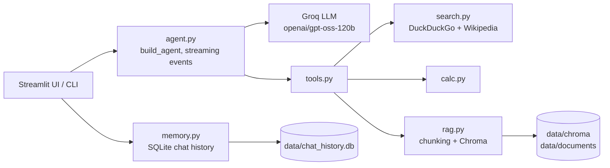

# AI Research Assistant

A conversational research assistant built with **LangChain** and **Groq**. It decides on its own when to search the web, look something up on Wikipedia, read your uploaded documents, or do maths, then answers with sources. It has a Streamlit web UI, a terminal interface, and chat history that survives restarts.

<!-- Add a screenshot or GIF after your first run: -->
<!--  -->

## Features

- **Tool-using agent**: web search (DuckDuckGo), Wikipedia, calculator, current date/time
- **Document Q&A (RAG)**: upload PDF, TXT or Markdown files; the agent searches them with semantic embeddings (Chroma) and cites file name and page
- **Source citations**: answers end with the URLs or document pages they came from
- **Streaming responses** and a live "Using web_search..." indicator
- **Persistent memory**: conversations are stored in SQLite and can be reopened later
- **Token control**: tool output is size-limited, chat history is windowed, and reply length is capped
- **Safe by design**: tool failures return readable errors instead of crashing, a recursion limit stops runaway tool loops, and the prompt treats tool output as untrusted data
- **Two interfaces** sharing the same agent: Streamlit web app and terminal chat
- **Tested and containerised**: unit tests, GitHub Actions CI, Dockerfile

## Architecture



The agent logic (`src/agent/`) is separate from the interfaces (`app/`). Tool wrappers in `tools.py` are thin; the real logic lives in plain modules (`calc.py`, `search.py`, `rag.py`) so it can be unit-tested without LangChain or network access.

## Quick start

Requirements: Python 3.10+ and a free [Groq API key](https://console.groq.com/).

```powershell
# 1. Create and activate a virtual environment (Windows PowerShell)
python -m venv venv
Set-ExecutionPolicy -Scope Process -ExecutionPolicy RemoteSigned
.\venv\Scripts\Activate.ps1
# macOS/Linux: python3 -m venv venv && source venv/bin/activate

# 2. Install dependencies
pip install -r requirements.txt

# 3. Add your API key
copy .env.example .env      # macOS/Linux: cp .env.example .env
# then edit .env and set GROQ_API_KEY=...
```

### Run the web app

```bash
streamlit run app/streamlit_app.py
```

### Run the terminal chat

```bash
python -m app.cli
```

Run both from the project root. Terminal commands: `/help`, `/new`, `/history`, `/load <id>`, `/docs`, `/add <path>`, `/remove <name>`, `exit`.

> The first document you index downloads a small embedding model (about 80 MB) once. After that it works offline.

## Example

```
You: What is 1234 multiplied by 5678?
  [tool] calculate
Agent: 1234 x 5678 = 7,006,652.

You: Who was Nikola Tesla?
  [tool] wikipedia_search
Agent: Nikola Tesla was a Serbian-American inventor and engineer known for his work on alternating current...
Sources: https://en.wikipedia.org/wiki/Nikola_Tesla
```

## Configuration

All settings live in `src/agent/config.py` and can be overridden in `.env`.

| Setting | Default | Purpose |
|---|---|---|
| `GROQ_API_KEY` | (required) | Groq API key |
| `MODEL_NAME` | `openai/gpt-oss-120b` | Groq model to use |
| `MAX_TOKENS` | `2048` | Reply cap. Reasoning tokens count too, so don't set it very low |
| `MAX_HISTORY` | `10` | Past messages sent to the model |
| `MAX_TOOL_CHARS` | `1500` | Characters of web/Wikipedia text returned per tool call |
| `DOC_CONTEXT_CHARS` | `3000` | Characters of document text returned per search |
| `RECURSION_LIMIT` | `15` | Max agent steps per question |
| `STREAMING` | `true` | Stream answers word by word |
| `LOG_LEVEL` | `WARNING` | Set to `INFO` to log every tool call with timing |

## Project structure

```
ai-research-assistant/
├── app/
│   ├── cli.py               # terminal interface
│   └── streamlit_app.py     # web interface
├── src/agent/
│   ├── config.py            # settings
│   ├── prompts.py           # system prompt
│   ├── agent.py             # builds the agent, streaming events
│   ├── tools.py             # LangChain tool wrappers
│   ├── search.py            # web + Wikipedia logic
│   ├── calc.py              # calculator logic
│   ├── rag.py               # chunking, Chroma index, document search
│   ├── memory.py            # SQLite chat history
│   └── utils.py             # truncation, helpers
├── tests/                   # unit tests (no API key or network needed)
├── data/                    # chat history, uploaded files, vector index (git-ignored)
├── .github/workflows/       # CI
├── Dockerfile
├── requirements.txt
└── .env.example
```

## Testing

```bash
pip install -r requirements-dev.txt
python -m pytest -q
```

The tests cover the calculator, truncation, SQLite memory, document chunking and indexing (with an in-memory stand-in for Chroma), search formatting and error handling, and the streaming event parser. They need no API key and make no network calls. GitHub Actions runs them on Python 3.11 and 3.12 for every push.

## Docker

```bash
docker build -t ai-research-assistant .
docker run -p 8501:8501 --env-file .env -v ai-data:/app/data ai-research-assistant
```

Then open http://localhost:8501. The `ai-data` volume keeps chat history and indexed documents between runs.

## Design decisions

- **Tool output is truncated per result**, so every source URL survives the size limit and the model can still cite it.
- **History is windowed** (`MAX_HISTORY`) and always starts on a user turn, which keeps token use predictable.
- **Tools never raise**: failures come back as text so one bad search doesn't end the conversation, and the model can explain or try another route.
- **`recursion_limit`** bounds how many tool calls one question can trigger.
- **Prompt-injection awareness**: the system prompt tells the model to treat web and document text as data, not instructions. This reduces the risk but doesn't eliminate it, so don't connect this agent to tools with side effects (sending email, deleting files) without extra safeguards.
- **Lazy imports** for LangChain and Chroma keep the pure logic importable and testable on its own.

## Limitations

- Web search uses DuckDuckGo's unofficial endpoint, which can be rate-limited. A key-based search API (for example Tavily) would be more reliable.
- Scanned PDFs need OCR before they can be indexed.
- Wikipedia search is English only.
- The agent answers from retrieved snippets, not full pages, so it can miss detail. Always check important facts against the cited sources.

## Roadmap

- Hybrid retrieval (keyword + semantic) and a re-ranker
- A small evaluation set that checks tool choice and answer quality
- LangSmith tracing
- Multi-user support with login

## Tech stack

Python, LangChain, Groq (`openai/gpt-oss-120b`), Streamlit, ChromaDB, SQLite, pypdf, DuckDuckGo (`ddgs`), pytest, Docker, GitHub Actions.
